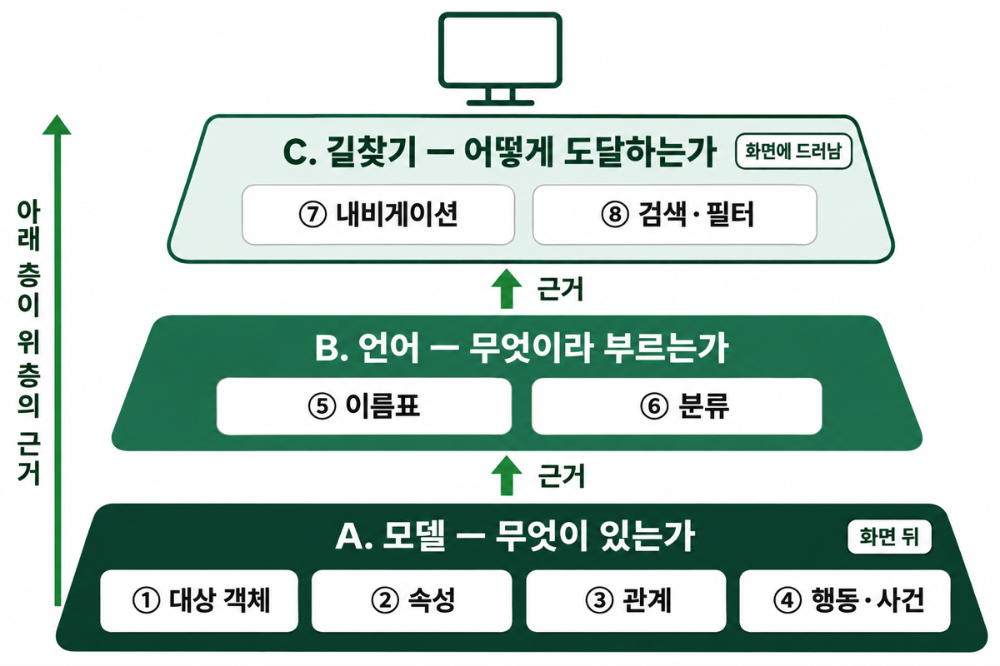

# Day 2 한눈에 보기 — IA 3층 8키워드와 여정 단계 예제

교재 Part 2에서 글로만 설명한 것을 그림과 표로 다시 보여 줍니다.

## 1. IA 3층 8키워드 (교재 37~41쪽 · 2.3절)

IA(정보구조)는 화면 목록이 아니라 **세 층으로 쌓인 구조**입니다.

- **A. 모델 — 무엇이 있는가.** 맨 아래 바탕입니다. 서비스에 어떤 대상 객체가 있고, 무엇을 갖고, 어떻게 이어지고, 무슨 일이 일어나는지입니다. 화면 뒤에 있어 사용자에게는 보이지 않습니다.
- **B. 언어 — 무엇이라 부르는가.** A층의 것들에 사용자가 알아듣는 이름을 붙이고, 어떤 기준으로 묶을지 정합니다.
- **C. 길찾기 — 어떻게 도달하는가.** 맨 위, 사용자가 화면에서 직접 만나는 메뉴·위치 표시·검색·필터입니다.

**아래 층이 위 층의 근거입니다.** 위층은 아래층 위에서만 설 수 있습니다. 그래서 정하는 순서도 아래에서 위로입니다. 화면에서 무언가 어색하다면, 원인은 대개 그보다 아래층에 있습니다.

## 2. 여정 단계 한눈에 보기 — 김도현 · 이서연 (교재 36쪽 · 2.2절)

교재 36쪽은 두 사람의 여정을 글로 설명합니다. 아래는 그 글을 박준혁 예제(35쪽)처럼 **단계 × 근거 날짜** 표로 옮긴 것입니다. 행동·생각·감정·접점·불편 칸은 교재 35쪽 박준혁 표의 모양을 따라 직접 채웁니다.

### 김도현 (남성 · 일반인) · `m-general` — "끊겼다가 다시 이어지기"

| | ① 의욕 있게 시작 | ② 회식과 흔들림 | ③ 공백 | ④ 다시 시작 | ⑤ 습관 굳히기 |
|---|---|---|---|---|---|
| 근거 날짜 | 10/12 아침 체중 85.4kg | 10/15 아침 체중 86.8kg (10/12보다 1kg 넘게 높음) · 10/15부터 걷기 없음 | 10/17~10/18 주말, 걷기에 식사·수면 기록까지 비어 있음 | 10/19 걷기 다시 시작 · 체중 85.4kg | 10/29 체중 84.8kg |
| 감정 | | | **-2** (가장 낮음) | | |
| 가장 큰 기회 | | | **공백 뒤 "첫날을 가볍게 다시 시작하게 돕는다"** | | |

### 이서연 (여성 · 일반인) · `f-general` — "미리 알 수 있는 공백"

| | ① 꾸준히 이어 가기 | ② 마감 주간에 무너짐 | ③ 기록까지 사라짐 | ④ 가볍게 다시 시작 | ⑤ 주 3회 목표에 다시 다가가기 |
|---|---|---|---|---|---|
| 근거 날짜 | 10/5~10/18 홈트 20~30분씩 주 3회 | 10/19~10/20 수면 4.8시간, 4.3시간 | 10/21~10/23 수면 기록 없음 · 10/19~10/23 식사 기록 없음 · 운동은 10/18 다음 기록이 10/25 | 10/25 "스트레칭·폼롤러 25분" | — (내가 기록에서 찾음) |
| 가장 큰 기회 | **② 직전: 마감 주간을 미리 알고 "5분 자세 루틴"처럼 끊기지 않는 최소 버전을 제안한다** | | | | |

### 두 사람을 나란히 보면

| | 김도현 | 이서연 |
|---|---|---|
| 공백이 생기는 이유 | 회식 — **갑자기** 생김 | 마감 일정 — **미리 알 수 있음** |
| 가장 큰 기회의 자리 | ③ 공백 **뒤** (다시 시작) | ② 무너지기 **직전** (끊기지 않게) |
| 박준혁(35쪽)과 다른 점 | 박준혁은 "강도 조절", 김도현은 "끊겼다가 다시 이어지기" | 같은 "끊김"이어도 기회가 앞쪽에 있음 |

같은 일곱 칸, 같은 4주라도 **기록이 끊기는 이유가 다르면 기회의 자리가 달라집니다.**
